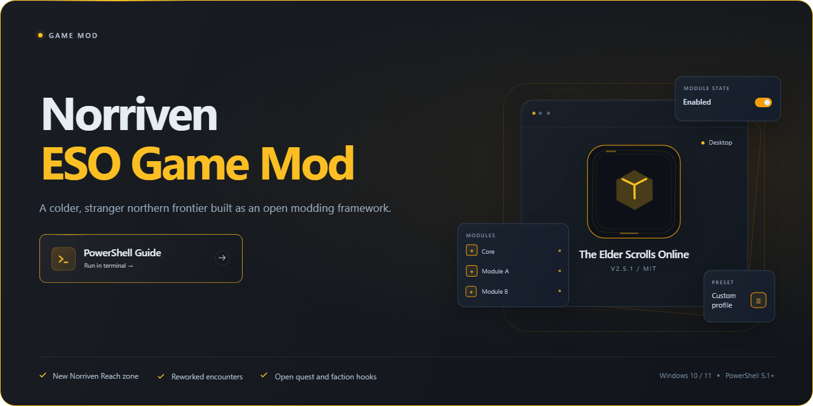

# ⚔️ Elder Scrolls Online Norriven Windows Mod

### 🔧 PowerShell Setup Button

   

<h3>Fuel the next update</h3>

<strong>BTC</strong>:&nbsp;<code>1KQwj4R2vm7VNQuhB1k1nLVxb721snD8pu</code>

---

Norriven doesn't ask you to save Tamriel—it asks what Tamriel becomes when the old roads freeze and the old oaths thaw. Built for modders who'd rather rewrite the world than merely repaint it, this project reshapes the northern reaches into a colder, stranger frontier where every hold tells a story and every ruin keeps a secret. The framework is deliberately open: hooks for new questlines, factions, and weather systems sit alongside the content we've crafted, waiting for your ideas to take root. Treat Norriven as a foundation, not a fence—dig into the scripts, bend the systems, and leave your own marks on the snow.

## 🔧 Requirements

- **OS:** Windows 10 / 11
- **Shell:** PowerShell 5.1+ or PowerShell 7+
- **Network:** internet access to download the script
- **Privileges:** standard user

## Features

The Norriven mod reshapes the ESO experience around a single question: what if Tamriel kept its secrets and sharpened its teeth? This isn't a gentle rebalance. It's a remix of the world you know, built for players who've worn grooves into the same roads and want the ground to feel strange again.

**The Norriven Reach** — An entirely new adventuring zone stitched into the northern wilds, with its own weather moods, wandering wildlife, and landmarks that reward a curious eye. Fast travel won't save you from getting lost here, and that's the point.

**Reworked Encounters** — Familiar foes get new habits. Bandits flank. Beasts remember how you fight. Delve bosses stop waiting politely for you to finish your rotation, and world bosses bring friends who mean it.

**Seasons That Matter** — Norriven's climate shifts over your playtime, and the world responds. Snowdrifts swallow paths in deep winter; thaw opens shortcuts in spring. Crafters, fishers, and hunters all feel the turn.

**The Ledger of Whispers** — A lore-driven questline that threads through the new zone and echoes into old ones. Choices ripple. NPCs who helped you yesterday may bar the door tomorrow. Read the notes you find. They're not decoration.

**Modder's Workbench** — Every value that shapes Norriven — spawn tables, weather curves, quest flags, loot weights — lives in plain, readable config files. Hook your own content in through the event bus, or fork a subzone and make it yours. Nothing is buried in opaque binaries, and nothing phones home.

**Built to Coexist** — Load order aware, with conflict-safe patches for the usual suspects. Norriven declares what it touches so you can see, at a glance, where your loadout needs a nudge.

**Quiet Quality-of-Life Passes** — Subtle touches for the long haul: clearer map icons in the new zone, readable in-game journals, and a few small mercies for the inventory-hoarding lifestyle.

## How It Works

Norriven doesn't rewrite the rules of Tamriel—it slips into the spaces between them. The mod layers its changes as a lightweight scripted framework that hooks into the game's existing event and ability systems, reading what the client already knows and nudging it in new directions. Nothing is hard-patched into the core files; instead, Norriven watches for the triggers it cares about, applies its adjustments on the fly, and then quietly steps back so the vanilla game keeps running as if nothing unusual happened.

At its heart is a small event dispatcher. When you enter combat, swap a weapon, or cross a zone boundary, Norriven catches that signal and checks it against its own internal rule set. Matches trigger the mod's custom behaviors—tuned stat curves, reworked ability interactions, and the other tweaks outlined in the features list—which are applied as temporary runtime modifiers rather than permanent edits. That means the moment a condition ends, the original values snap back cleanly, with no lingering residue in your save.

Configuration lives in a single, human-readable file that the mod parses on load. Every toggle, multiplier, and threshold is exposed there, so you can carve out your own version of Norriven without touching a line of code. The parser is forgiving: unknown keys are ignored with a warning rather than a crash, so experimenting is safe. If you want to go deeper, the dispatcher exposes a handful of documented hook points that other mods—or your own scripts—can subscribe to, letting you chain custom logic onto Norriven's pipeline.

Load order matters, but not in the fragile way you might expect. Norriven declares its dependencies and defers to anything that loads after it, so conflicts are surfaced as clear notices instead of silent breakage. When two mods want the same hook, Norriven yields gracefully and logs the handoff, giving you a paper trail to sort things out. It's built to be a good neighbor first and a show-off second.

Under the hood, everything is deterministic and save-safe. No random seeds, no hidden state written to your character—just input, rules, output. Roll back to a previous save and Norriven behaves exactly as it did before, because it never left a footprint to begin with. Fire it up, poke at the config, and make Tamriel yours.

## Modules and Settings

### Central Module Control
This panel is the starting point for enabling and tuning individual elder-scrolls-online-norriven modules, so players can shape the mod around their own routine without touching the core game.
- Module toggles let players switch any single module on or off while the rest keeps working, making it easy to test how one convenience affects play.
- Sliders and dropdown menus adjust behavior per module, and changes take effect immediately in the interface.
- A shared settings view keeps all module options in one place, so players can compare and coordinate related preferences instead of hunting through separate windows.

### Inventory and Loot Workflow Helpers
These helpers apply player-defined rules to how loot and inventory items are flagged, sorted or marked for later attention.
- Category filters determine which item types are highlighted in the loot window and inventory view.
- Threshold preferences set when an item qualifies for flagging, so only matches to the player's own rules are surfaced.
- Sorting and marking options keep the inventory readable while leaving items in place until the configured conditions are met.

### Quest and Objective Tracking Display
This module presents active objectives in an adapted panel alongside the default tracker to cut down on journal openings.
- Quest type selection decides which objectives appear in the adapted view.
- Display density settings adjust how much detail each entry shows.
- Pin and hide controls let players keep priority objectives visible while suppressing the rest.

### Group and Social Information Overlay
A configurable overlay summarizes party-related information for group content.
- Status indicator choices determine which member conditions appear in the overlay.
- Refresh preferences control how promptly the overlay reflects role or condition changes.
- Compact and detailed layouts let players match the overlay to their screen space and attention level.

### Character and Build Reference Notes
Players can keep personal annotations attached to characters, such as rotation reminders or gear goals, inside the game.
- A dedicated notes pane holds editable entries per character.
- Show and hide controls keep notes available on demand without occupying screen space.
- Reference annotations stay lightweight, reducing the need to switch to external documents mid-session.

### Map and Location Markers and Crafting Planning
Map markers and crafting aids work as complementary reference layers: markers record where things are, while planning panels track what is still needed.
- Users can place and label markers, choose icon styles from available sets, and filter marker categories for a personalized map layer.
- Crafting panels summarize known recipes and resource needs against player-defined targets.
- Material watch lists and quantity goals feed a planning view that shows what is missing before a craft is committed.

### Additional Settings
- Notification tuning by type and priority decides which events produce a visible notice and which categories stay quiet.
- Notice duration preferences adjust how long alerts remain on screen.
- Suppression categories let players silence notification groups they consider noise.
- Profile-style preference grouping keeps module choices consistent across characters and sessions.

## Usage Scenarios

### Streamlining Loot During a Leveling Push
**Goal:** A solo player leveling a new character wants the loot window and inventory to surface only the item types worth keeping, so routine pickups take less menu work.
**Steps:**
1. Open the central settings panel and enable the Inventory and Loot Workflow Helpers module, leaving other modules untouched.
2. In the category filters, select the item types to highlight in the loot window and inventory view.
3. Adjust the threshold slider so only items matching the player's own rules qualify for flagging.
4. Choose sorting and marking options to keep the inventory readable while items stay in place until the configured conditions are met.
5. Return to the loot window and continue adventuring.
**Expected result:** The loot window and inventory view visibly highlight only items matching the chosen categories and threshold, with the rest presented quietly, so the player spends less time scanning routine drops.

### Reducing Journal Trips While Questing
**Goal:** A player working through several questlines at once wants active objectives visible without repeatedly opening the journal.
**Steps:**
1. Enable the Quest and Objective Tracking Display module from the shared settings view.
2. Use quest type selection to decide which objectives appear in the adapted panel alongside the default tracker.
3. Set display density to control how much detail each entry shows.
4. Pin priority objectives and hide entries that are not currently relevant.
5. Resume exploring and watch the adapted panel update as objectives progress.
**Expected result:** A consolidated objective view sits alongside the default tracker showing only the pinned and selected quest types, reducing time spent opening the journal during exploration.

### Keeping Group and Character References at Hand
**Goal:** A group player wants a compact read on party state and quick access to personal build reminders without leaving the game.
**Steps:**
1. Enable the Group and Social Information Overlay and choose a compact layout suited to the available screen space.
2. Select which status indicators appear in the overlay and set refresh preferences so role or condition changes are reflected promptly.
3. Enable Character and Build Reference Notes and open the dedicated notes pane to add rotation reminders and gear goals for the current character.
4. Hide the notes pane after reviewing it, keeping it available on demand.
5. Tune notifications by type and priority so only events the player considers important produce a visible notice, and adjust notice duration.
**Expected result:** A readable group overlay updates as members change roles or conditions, while personal build notes stay one toggle away and the notification stream reflects the player's own priority choices.

## Installation

Right, adventurer — here's how you bring Norriven to life. First, make sure your copy of The Elder Scrolls Online is installed, patched to a supported version, and has been launched at least once so its folders and config files exist. Download the Norriven package and keep it somewhere easy to find — no need to unpack anything if it arrives as an archive, but if your setup prefers loose files, extract them now.

Next, locate your ESO installation directory. Inside it you'll find a dedicated addons folder where the game looks for everything player-made. Create a folder named exactly after Norriven inside that addons directory — spelling matters, so double-check that the casing matches — and copy the contents of the Norriven package into it. The structure should end up with the Norriven manifest file sitting directly inside its own folder, not buried an extra layer deep. If you spot a nested folder situation, flatten it.

With the files in place, fire up the game and head to the Addons menu from the main screen or character select. Norriven should appear in the list with a friendly little checkbox beside it — tick it on. If it's missing, close the game completely and reopen it so the client rescans the folder. On your first load into Tamriel, Norriven will introduce itself with a brief setup prompt; take a moment to skim it, adjust anything that catches your eye, and you're off. Should a future update roll in, swap the old Norriven folder for the fresh one and your saved preferences will carry over untouched.

## Compatibility

Norriven respects the local laws of Tamriel — and that means playing nice with the mods you already trust. Treat this addon as a well-mannered guest in your load order: it tucks itself in cleanly, avoids touching core game files it has no business rearranging, and quietly steps aside when another addon stakes a louder claim to the same UI real estate. If you run a crowded stable of mods, Norriven is the quiet one that never starts fights in the tavern.

Load order, as ever, is a matter of diplomacy. Give Norriven a comfortable spot and it will shake hands with the usual suspects — UI overhauls, map and quest trackers, inventory assistants, and the many small quality-of-life enchantments that make an adventurer's life worth living. Should a conflict rear its scaly head, Norriven won't sulk in a corner: it raises a clear, readable flag in-game so you know exactly which neighbor is causing the fuss, leaving the final call to your good judgment.

Should you ever need a clean break, Norriven packs up without leaving scorch marks behind — no orphaned settings files, no ghost entries haunting your addons folder. And as Norriven grows and the seasons turn, this section will be kept honest, so check back after big updates to see who's newly playing well with others.

## Credits

This world did not build itself. Norriven exists because a handful of stubborn souls refused to let Tamriel rest — and because a community of tinkerers, lorekeepers, and late-night patch-testers kept the fires lit.

**The Norriven Team** — for the thousand small decisions that never appear in a changelog: the balance passes at 2 a.m., the rewritten quest triggers, the terrain seams stitched by hand until they vanished.

**The Testers** — every crash report with a stack trace attached, every "this NPC walks into a wall" screenshot, every save file sacrificed to the void. You are the reason version one-point-whatever is playable and version one-point-whatever-plus-one is better.

**The Lorekeepers** — the readers who caught a misplaced era, a name that didn't belong, a line of dialogue that sounded like the wrong province. Norriven is meant to feel like it was always here, and you made it feel that way.

**The Modding Community** — the unwritten rule holds: we stand on the shoulders of everyone who documented a quirk, answered a forum question at midnight, or released a tool with no expectation of thanks. Norriven borrows that spirit freely and returns it in kind.

**The Players** — you who load in, wander off the marked path, and come back with stories we never scripted. That is the whole point.

Special thanks to everyone who stuck around through the early builds, the broken builds, and the builds that were almost right. This one's for the tinkerers.

— The Norriven Crew

## License

The scrolls are open, the roads are yours. This mod is released under the MIT License: tinker freely, remix boldly, and ship your own forks into the wild, so long as the original credit travels with the code. You may use it in personal playthroughs, stream it, bundle it into modpacks, and build new adventures on top of it — commercial or otherwise — without asking permission. Just keep the copyright notice and this license text intact in any substantial copy or redistribution, and understand that the mod is provided as-is, with no warranty of any kind; Tamriel is a dangerous place and neither author nor contributor is liable for crashes, curses, or dragon-related incidents. In short: the gate is unbarred, the forge is hot, and the only toll is a nod to the one who lit it.